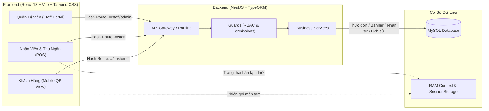

# Hệ Thống Tài Liệu Dự Án: Huy CV — Quán Vỉa Hè

> **Dự án**: Hệ thống Gọi Món Tại Bàn Qua QR Code & Quản Lý Vận Hành Quán Vỉa Hè  
> **Repository**: `netsjs` (Fullstack Monorepo: `frontend/` + `backend/`)  
> **Cập nhật gần nhất**: 03/11/2026  
> **Trạng thái**: Hoạt động sản xuất & Phát triển liên tục (Production & Active Dev)

---

## 1. Giới Thiệu & Kiến Trúc Tổng Quan

**Huy CV — Quán Vỉa Hè** là giải pháp số hóa toàn diện dành cho các quán ăn, quán ốc, quán nướng mô hình vỉa hè và ẩm thực đường phố:
- **Khách hàng**: Quét mã QR tại bàn, xem thực đơn số sinh động, tùy biến món (ghi chú), kiểm tra giỏ hàng và gửi order thẳng về quầy phục vụ mà **không cần tải app hay đăng ký tài khoản**.
- **Nhân viên & Thu ngân**: Theo dõi sơ đồ bàn theo thời gian thực (Trống, Đang phục vụ, Đã gửi đồ, Chờ tính tiền), nhận đơn gọi món, in hóa đơn và thanh toán một chạm.
- **Quản trị viên (Chủ quán)**: Quản lý danh mục, món ăn, banner khuyến mãi trang chủ, báo cáo doanh thu tổng quan và phân quyền chi tiết cho nhân viên.



---

## 2. Bản Đồ Tài Liệu (Documentation Directory Map)

Để bất kỳ kỹ sư hoặc agent mới tiếp nhận dự án có thể nắm bắt ngay yêu cầu, thiết kế và tiến độ, toàn bộ tài liệu được phân loại chuẩn mực như sau:

| Thư mục / Tập tin | Nội dung chi tiết | Liên kết nhanh |
| :--- | :--- | :--- |
| **Yêu Cầu & Nghiệp Vụ** | | |
| `docs/requirements/user-stories/README.md` | Ma trận truy xuất nguồn gốc (Traceability Matrix: `US-CUST`, `US-OPS`, `US-ADM`) | [Xem Ma Trận](./requirements/user-stories/README.md) |
| `docs/requirements/user-stories/khach-hang.md` | 7 User Stories luồng khách hàng (`US-CUST-01` đến `US-CUST-07`) | [Khách Hàng](./requirements/user-stories/khach-hang.md) |
| `docs/requirements/user-stories/van-hanh-ban.md` | 8 User Stories vận hành bàn ăn (`US-OPS-01` đến `US-OPS-08`) | [Vận Hành Bàn](./requirements/user-stories/van-hanh-ban.md) |
| `docs/requirements/user-stories/admin.md` | 8 User Stories quản trị & 2 đề xuất mở rộng (`US-ADM-01..08`, `US-EXT-01..02`) | [Quản Trị](./requirements/user-stories/admin.md) |
| `docs/requirements/business-rules.md` | Quy tắc nghiệp vụ cốt lõi (Không bắt buộc login, phiên bàn FIFO, 3 trạng thái bàn,...) | [Quy Tắc Nghiệp Vụ](./requirements/business-rules.md) |
| **Thiết Kế Kỹ Thuật** | | |
| `docs/design/architecture.md` | Kiến trúc hệ thống, sơ đồ component, luồng dữ liệu, phân tách ranh giới | [Kiến Trúc](./design/architecture.md) |
| `docs/design/data-model.md` | Sơ đồ thực thể quan hệ (ERD Mermaid), cấu trúc 5 bảng MySQL & đề xuất | [Mô Hình Dữ Liệu](./design/data-model.md) |
| `docs/design/api-routes.md` | Danh mục endpoint REST API chi tiết kèm phương thức, tham số và mã lỗi | [API Routes](./design/api-routes.md) |
| **Kế Hoạch & Báo Cáo** | | |
| `docs/superpowers/plans/` | Các kế hoạch kỹ thuật theo task (Menu, Banner, RBAC, Reload Flash, Overview, Audit) | [Thư Mục Kế Hoạch](./superpowers/plans/) |
| `docs/reports/` | Báo cáo kiểm chứng, bằng chứng xác minh và kết quả nghiệm thu theo task | [Thư Mục Báo Cáo](./reports/) |
| `docs/audits/` | Báo cáo kiểm kê mock & khảo sát module (`mock-and-module-gap-audit.md`, `backend-module-survey.md`) | [Báo Cáo Kiểm Kê](./audits/mock-and-module-gap-audit.md) |
| **Giao Diện & Kiểm Thử** | | |
| `docs/ui/design-system.md` | Design System: màu sắc Quán Vỉa Hè, typography, responsive, trạng thái UI UX Pro Max | [Design System](./ui/design-system.md) |
| `docs/testing/playwright-lifecycle.md` | Quy trình kiểm thử Playwright 6 pha chuẩn mực không can thiệp database | [Playwright Lifecycle](./testing/playwright-lifecycle.md) |
| `docs/testing/lan-qr-demo-guide.md` | Hướng dẫn thử nghiệm gọi món qua QR bằng điện thoại (Mạng LAN) | [Hướng Dẫn Demo LAN](./testing/lan-qr-demo-guide.md) |
| `docs/changelog/` | Nhật ký thay đổi theo ngày (`2026-11-02.md`, `2026-11-03.md`, `2026-11-04.md`) | [Changelog](./changelog/) |

---

## 3. Quy Trình Làm Việc Chuẩn (Standard Engineering Workflow)

Mọi kỹ sư và tác nhân trí tuệ nhân tạo (Agent) khi làm việc trên dự án phải tuân thủ nghiêm ngặt quy trình 8 bước:

```
[1. Đọc yêu cầu / User Story] 
          ↓
[2. Lập kế hoạch (docs/superpowers/plans/)] 
          ↓
[3. Triển khai kỹ thuật (Frontend / Backend)] 
          ↓
[4. Kiểm chứng độc lập (Lint / Build / Playwright)] 
          ↓
[5. Báo cáo nghiệm thu (docs/reports/)] 
          ↓
[6. Cập nhật nhật ký ngày (docs/changelog/)] 
          ↓
[7. Commit & Push mã nguồn (Git)] 
          ↓
[8. Bàn giao kết quả]
```

### Chi Tiết Từng Bước:
1. **Đọc yêu cầu / User Story**: Đối chiếu mã công việc với các User Story trong `docs/requirements/user-stories/` và quy tắc nghiệp vụ trong `docs/requirements/business-rules.md`.
2. **Lập kế hoạch**: Viết kế hoạch triển khai vào thư mục `docs/superpowers/plans/YYYY-MM-DD-<task-name>-plan.md` xác định rõ mục tiêu, tiêu chí nghiệm thu (AC), tệp tác động và lệnh kiểm chứng.
3. **Triển khai kỹ thuật**: Lập trình giải pháp theo nguyên tắc sạch, tối ưu, giữ nguyên phong cách và bảng màu quán vỉa hè (`Bang_mau_Quan_Via_He.md`).
4. **Kiểm chứng độc lập**: Chạy linter, build thử nghiệm và kiểm thử Playwright. Chỉ nghiệm thu khi 100% bài test pass và không có lỗi biên dịch.
5. **Báo cáo nghiệm thu**: Lập văn bản báo cáo kết quả tại `docs/reports/YYYY-MM-DD-<task-name>-report.md` đính kèm log đầu ra của lệnh kiểm thử.
6. **Cập nhật nhật ký**: Ghi nhận công việc hoàn thành vào tệp nhật ký theo ngày `docs/changelog/YYYY-MM-DD.md`.
7. **Commit & Push**: Tạo commit với thông điệp rõ ràng theo định dạng conventional commits (`feat:`, `fix:`, `docs:`, `test:`,...) và đẩy lên kho chứa từ xa (`git push`).
8. **Bàn giao**: Trình bày tóm tắt kết quả kèm các liên kết dẫn chứng đến tài liệu vừa cập nhật.

---

## 4. Ràng Buộc Bất Di Bất Dịch: ZERO DATABASE INTERFERENCE

Khi thực hiện các tác vụ sửa lỗi giao diện, điều hướng, refactor hoặc chạy kiểm thử:
> [!CAUTION]
> **TUYỆT ĐỐI CẤM CÁC HÀNH VI SAU ĐỐI VỚI CƠ SỞ DỮ LIỆU**:
> 1. Không dùng công cụ SQL trực tiếp hoặc ORM scripts để xóa, sửa hoặc thao túng dữ liệu kinh doanh thật của quán.
> 2. Không chạy các lệnh reset, truncate, seed hoặc reseed database.
> 3. Không chạy migration làm thay đổi cấu trúc bảng hoặc schema sync làm hỏng ràng buộc đang có.
> 4. Không đổi mật khẩu, xóa quyền hoặc vô hiệu hóa tài khoản Quản trị viên (`admin`) đang hoạt động.
> 5. Không viết thông tin nhạy cảm (mật khẩu, token bí mật, file `.env`) vào tài liệu Markdown hoặc Git log.

---

## 5. Hướng Dẫn Khởi Động & Kiểm Thử Dự Án

### Cài Đặt Ban Đầu
```bash
# Cài đặt thư viện frontend
npm --prefix frontend install

# Cài đặt thư viện backend
npm --prefix backend install
```

### Khởi Động Môi Trường Phát Triển
```bash
# Khởi động Backend (Port 3000)
npm run dev:back

# Khởi động Frontend (Port 5173)
npm run dev:front
```

### Kiểm Tra Chất Lượng Mã Nguồn & Bản Dựng
```bash
# Kiểm tra linter
npm --prefix frontend run lint

# Biên dịch frontend
npm --prefix frontend run build

# Biên dịch backend
npm --prefix backend run build
```

### Chạy Kiểm Thử Tự Động Toàn Diện (Playwright E2E)
```bash
# Chạy toàn bộ 8 bài kiểm tra E2E độc lập (không chạm DB)
npx playwright test

# Chạy có giao diện UI tương tác
npx playwright test --ui
```

