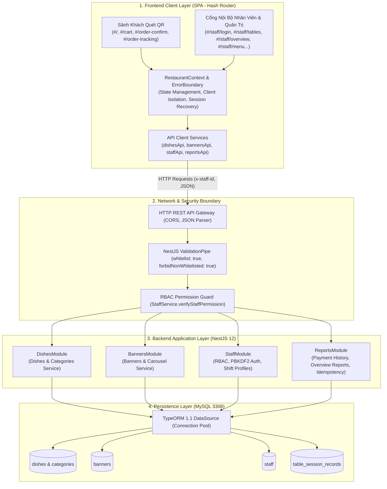

# Kiến Trúc Hệ Thống (System Architecture)

Tài liệu mô tả kiến trúc tổng thể, mô hình phân lớp và các luồng dữ liệu chính của hệ thống **Huy CV — Quán Vỉa Hè**.

---

## 1. Mô Hình Kiến Trúc Tổng Thể

Hệ thống được thiết kế theo mô hình Monorepo Client-Server phân tầng rõ ràng:



---

## 2. Kiến Trúc Frontend (React 19 + TypeScript + Vite)

### 2.1. Điều Hướng Độc Lập Bằng URL Hash Router
- **Tại sao dùng Hash Router:** Khách hàng sử dụng trình duyệt di động quét mã QR, khi refresh hoặc mở qua Zalo/Safari trong WebView, Hash Router (`/#/` và `/#/staff/*`) loại bỏ hoàn toàn sự cố 404 khi người dùng F5 hoặc bấm Back/Forward mà không cần cấu hình rewrite phức tạp trên web server.
- **Phân tách không gian:**
  - `/#/` đến `/#/order-tracking`: Tuyệt đối công khai, không yêu cầu phiên đăng nhập.
  - `/#/staff/*`: Được bảo vệ bởi `AdminLayout` và cờ xác thực `isAuthChecking`. Nếu phiên chưa hợp lệ hoặc tài khoản bị khóa, tự động chuyển về trang đăng nhập `/#/staff/login`.

### 2.2. Quản Lý Trạng Thái Tập Trung (`RestaurantContext.tsx`)
- Quản lý đồng bộ: `dishes`, `categories`, `banners`, `staffList`, `tables`.
- **Triệt tiêu Mock State:** Toàn bộ danh sách khởi tạo rỗng `[]` và nạp bất đồng bộ từ MySQL API, hiển thị Skeleton Loader dạng pulse chống hiện tượng nhảy số hoặc giật layout (CLS).
- **Bộ đệm giỏ hàng cô lập theo bàn:** Sử dụng `sessionStorage` với key dạng `huycv_cart_<tableNumber>`, đảm bảo khách bàn A không thấy món của bàn B.

### 2.3. Lớp Phòng Thủ Lỗi Giao Diện (`ErrorBoundary.tsx`)
- Bao bọc toàn bộ các view hiển thị tại `App.tsx`.
- Khi có bất kỳ ngoại lệ render không lường trước nào phát sinh (như truy cập thuộc tính trên null), Error Boundary lập tức bắt lỗi và hiển thị giao diện thông báo ấm áp thân thiện kèm nút "Tải lại", ngăn chặn việc sập toàn bộ ứng dụng thành màn hình trắng trơn.

---

## 3. Kiến Trúc Backend (NestJS 12 + TypeScript ESM + TypeORM)

### 3.1. Ranh Giới Mạng & Xác Thực Dữ Liệu Chặt Chẽ
- Kích hoạt toàn cục `ValidationPipe`:
  ```typescript
  app.useGlobalPipes(new ValidationPipe({ whitelist: true, forbidNonWhitelisted: true, transform: true }));
  ```
  Ngăn chặn triệt để việc client gửi các trường mở rộng không nằm trong DTO (ví dụ trường hiển thị `categoryName` khi sửa món ăn).
- Chuẩn hóa payload tại API Client frontend (`sanitizeDishPayload`, `sanitizeBannerPayload`, `sanitizeStaffPayload`) trước khi đóng gói JSON request.

### 3.2. Mô Hình Phân Quyền Vai Trò (RBAC) Tại Dịch Vụ
- Không dựa vào JWT phức tạp gây cồng kềnh cho quán vỉa hè.
- Header `x-staff-id` được gửi kèm request nội bộ. `StaffService.verifyStaffPermission(staffId, permissionKey)` kiểm tra danh tính trực tiếp trong MySQL:
  - Nếu tài khoản không tồn tại hoặc `status === 'suspended'`: Ném ra `UnauthorizedException` hoặc `ForbiddenException` HTTP 403.
  - Nếu cờ quyền tương ứng là `false`: Từ chối thao tác ngay lập tức.
  - Kiểm tra tự vệ: Ngăn chặn xóa hoặc hạ quyền tài khoản Admin cuối cùng của quán.

### 3.3. Cơ Chế Xử Lý Giao Dịch Thu Tiền Idempotent
- `ReportsService.recordPayment` kiểm tra tính duy nhất của `sessionId`.
- Nếu phát hiện khóa trùng lặp, backend trả về bản ghi hiện tại với thông điệp Idempotent, đảm bảo tổng doanh thu trong báo cáo và dashboard không bao giờ bị tính lặp.

---

## 4. Các Luồng Vận Hành Chính

1. **Luồng Khách Quét QR:** Quét QR ➔ Nạp số bàn ➔ Duyệt thực đơn & chọn món ➔ Xem giỏ hàng ➔ Gửi đơn gọi món (`/api/dishes/validate-order`) ➔ Theo dõi trạng thái đơn hàng (`/order-tracking`).
2. **Luồng Vận Hành Quán:** Mở bàn (`ordered`) ➔ Bếp chuẩn bị món ➔ Phục vụ bưng món ra bàn ➔ Thu đủ tiền mặt/chuyển khoản ➔ Bấm "Đã phục vụ & Thu đủ tiền" (`/api/reports/payments`) ➔ Bàn chuyển sang `seated` ➔ Khách rời quán ➔ Dọn dẹp bàn ➔ Chuyển bàn về `empty`.
3. **Luồng Quản Trị & Báo Cáo:** Đăng nhập 2 bước ➔ Vào Dashboard Tổng quan (`/api/reports/overview`) ➔ Quản lý món/danh mục/banner/nhân viên ➔ Tra cứu lịch sử thu tiền (`/api/reports/payment-history`).

