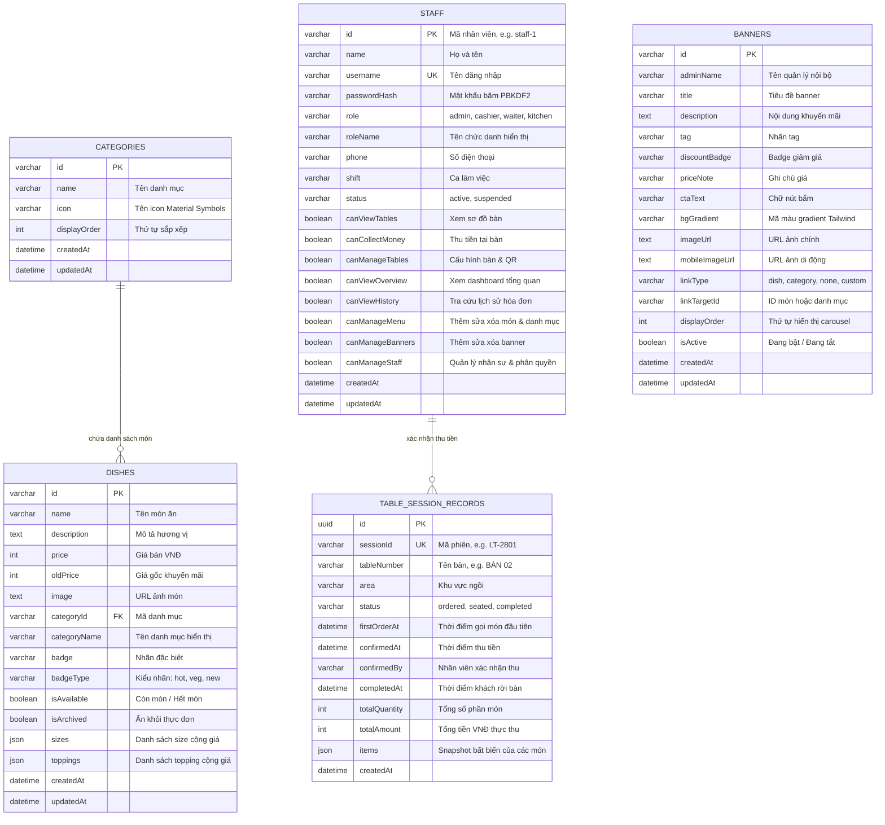

# Mô Hình Dữ Liệu & Thực Thể Cơ Sở Dữ Liệu (Data Model)

Tài liệu đặc tả chi tiết cấu trúc dữ liệu, các bảng trong MySQL và các kiểu dữ liệu snapshot được sử dụng trong hệ thống **Huy CV — Quán Vỉa Hè**.

---

## 1. Sơ Đồ Thực Thể Hiện Có Trong MySQL (Entity-Relationship)



---

## 2. Chi Tiết Các Cấu Trúc Snapshot JSON

### 2.1. Cấu trúc `sizes` trong bảng `dishes`
Mỗi món ăn có thể có nhiều kích cỡ:
```json
[
  { "id": "s-std", "name": "Tiêu chuẩn (1 Tô vừa)", "price": 0 },
  { "id": "s-big", "name": "Tô lớn (+thịt bò)", "price": 10000 }
]
```

### 2.2. Cấu trúc `toppings` trong bảng `dishes`
Các món phụ thêm kèm giá cộng thêm:
```json
[
  { "id": "top-1", "name": "Chả cua thêm", "price": 10000 },
  { "id": "top-2", "name": "Trứng cút (3 quả)", "price": 5000 }
]
```

### 2.3. Cấu trúc Snapshot `items` trong bảng `table_session_records`
Được đóng băng tại thời điểm xác nhận thu tiền nhằm đảm bảo tính bất biến của hóa đơn kiểm toán:
```json
[
  {
    "itemId": "item-179367-1",
    "dishId": "dish-1",
    "name": "Bún bò Huế đặc biệt",
    "sizeName": "Tô lớn (+thịt bò)",
    "toppings": ["Chả cua thêm"],
    "notes": "Ít cay, nhiều hành",
    "quantity": 2,
    "unitPrice": 65000,
    "totalPrice": 130000
  }
]
```

---

## 3. Thiết Kế Đề Xuất Bổ Sung: Module Bàn Ăn (Pending Review)

> [!NOTE]
> Bảng dưới đây là **thiết kế đề xuất chuẩn bị review**, tuân thủ nguyên tắc không tự can thiệp database của nhiệm vụ.

### 3.1. Bảng `dining_tables`
```sql
CREATE TABLE dining_tables (
  id VARCHAR(50) PRIMARY KEY,
  table_number VARCHAR(50) NOT NULL UNIQUE,
  area VARCHAR(100) NOT NULL DEFAULT 'Vỉa hè trước quán',
  status ENUM('empty', 'ordered', 'seated') NOT NULL DEFAULT 'empty',
  qr_code_url TEXT,
  display_order INT DEFAULT 0,
  is_active BOOLEAN DEFAULT TRUE,
  created_at DATETIME DEFAULT CURRENT_TIMESTAMP,
  updated_at DATETIME DEFAULT CURRENT_TIMESTAMP ON UPDATE CURRENT_TIMESTAMP
);
```

### 3.2. Bảng `active_table_sessions`
```sql
CREATE TABLE active_table_sessions (
  session_id VARCHAR(50) PRIMARY KEY,
  table_id VARCHAR(50) NOT NULL,
  first_order_at DATETIME NOT NULL,
  status ENUM('ordered', 'seated') NOT NULL DEFAULT 'ordered',
  items JSON NOT NULL,
  total_quantity INT NOT NULL DEFAULT 0,
  total_amount INT NOT NULL DEFAULT 0,
  notes TEXT,
  created_at DATETIME DEFAULT CURRENT_TIMESTAMP,
  FOREIGN KEY (table_id) REFERENCES dining_tables(id) ON DELETE CASCADE
);
```

